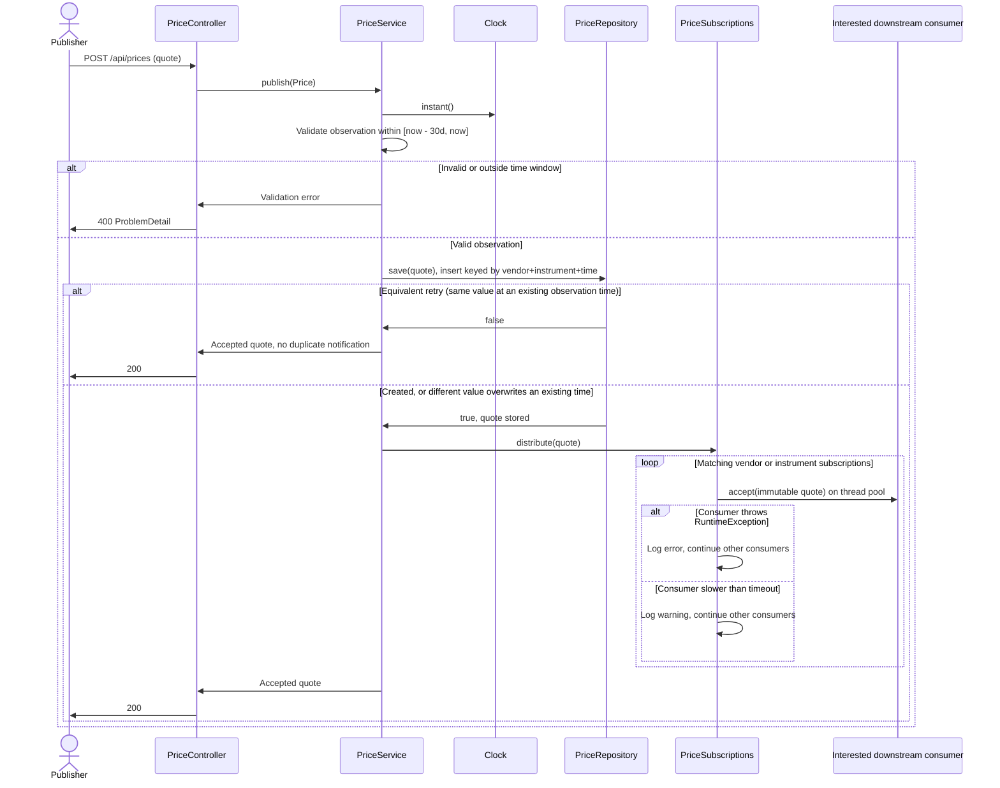
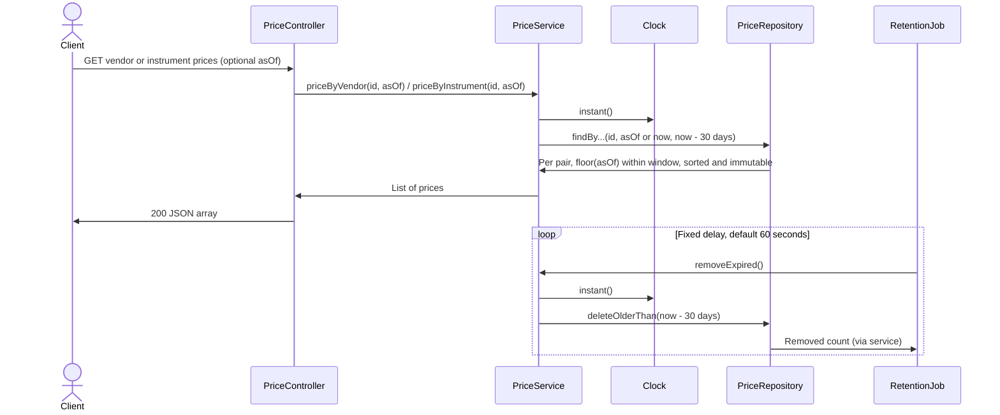
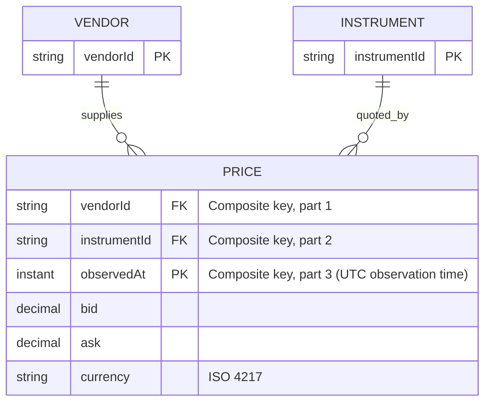

# Vendor price cache

A Java 17 / Maven application that caches vendor prices for traded
instruments, retaining every observation from the last **30 days** per
**(vendor, instrument)** pair, exposes publishing and lookup REST APIs, and
distributes accepted updates to interested in-process downstream consumers.

## Run and demonstrate

Requires JDK 17+ and Maven 3.6.3+. From PowerShell:


The script publishes REUTERS/AAPL, BLOOMBERG/AAPL and REUTERS/MSFT.
The vendor query returns two REUTERS prices; the instrument query returns
the two AAPL prices from different vendors. Use `-BaseUrl` for another server.
Repeating the script appends new observations for the same pairs at a newer
observation time, growing their 30-day history.

A separate, deterministic Java API demo also demonstrates downstream delivery
and removal after advancing the clock by 31 days, without starting a server:

```powershell
mvn dependency:build-classpath -Dmdep.outputFile=target\classpath.txt
$dependencies = (Get-Content .\target\classpath.txt -Raw).Trim()
java -cp ".\target\classes;$dependencies" com.example.prices.demo.Demo
```

It prints three DOWNSTREAM AAPL notifications, the latest vendor and instrument
query results, an as-of result that returns the earlier REUTERS/AAPL
observation, an empty result after 31 days, and EXPIRED QUOTES REMOVED: 4.
The fixed November 2026 timestamps are intentional for reproducibility.

## API

| Method | Path | Result |
| --- | --- | --- |
| POST | /api/prices | Publish a quote; 200 with accepted quote |
| GET | /api/prices/vendors/{vendor}?asOf={ts} | One price per instrument from one vendor, latest or as-of `asOf` |
| GET | /api/prices/instruments/{instrument}?asOf={ts} | One price per vendor for one instrument, latest or as-of `asOf` |

The optional `asOf` query parameter is an ISO 8601 instant. When omitted, each
query returns the **latest** price per pair; when supplied, asOf returns the
***as-of*** price — the most recent observation at or before `asOf` — per pair.
Pairs with no observation in force at that time (or outside the 30-day window)
are omitted. A malformed `asOf` returns 400. The controller models this
optionality as an `Optional<Instant>` carried into the service (absent means
"latest"); the service resolves it to a concrete instant before calling the
repository, so the per-pair query hot path stays allocation-free.

Example request (replace the timestamp with a recent UTC observation):

```json
{
  "vendor": "REUTERS",
  "instrument": "AAPL",
  "bid": 225.05,
  "ask": 225.15,
  "currency": "USD",
  "observedAt": "2026-11-09T12:00:00Z"
}
```

Prices use `BigDecimal`, not binary floating point. Negative and zero prices
are allowed because some traded instruments can legitimately have them.
Identifiers are trimmed, nonblank and case-sensitive. Currency must be a
recognized uppercase ISO 4217 code. Clients must coordinate instrument
identifiers and interpret currency when comparing prices; there is no FX conversion.
Unknown vendors/instruments return `200 []`. Results have stable
vendor/instrument ordering. Invalid, future or already-expired
quotes return 400. A different value for an already-recorded observation
timestamp overwrites the stored value (last write wins); re-sending an
identical observation is idempotent. Errors use Spring's RFC 9457
`ProblemDetail` JSON format.

## 1. Design and sequence diagrams

The design separates HTTP transport, business rules, persistence, and
distribution. The cache holds a **30-day history of observations** per
(vendor, instrument) pair: each distinct observation time is retained in a
time-sorted series, not only the latest snapshot. Lookups return one price per
pair — the latest by default, or the ***as-of*** price at a client-supplied time.
This directly supports both the two requested lookup shapes and paint-in-time
queries over the recent history. Observations are evicted individually once they
fall outside the 30-day window; vendors never overwrite each other's quotes.

### Publish, persist, then distribute



Persisting first means consumers can retrieve an accepted observation. Each
subscriber callback runs on a thread pool rather than on the publishing thread,
so a slow or unresponsive consumer cannot stall fan-out to the others; if a
delivery does not complete within the configured timeout, a warning is logged
and distribution to the remaining subscribers continues. Callbacks therefore
also run outside the repository lock, so reentrant lookups do not hold up
persistence. An equivalent retry compares decimal values numerically
(`100.0` == `100.00`) and currency for the same observation time; it does not send
another event; a different value at that same time overwrites the stored quote
(last write wins) and is re-distributed.

### Retrieval and retention



Retention defaults to **30 x 24 hours**, calculated with `Instant` in UTC, not
calendar months or local dates. The window is configurable via the
`prices.retention-days` property (see `src/main/resources/application.properties`
or override with `--prices.retention-days=7`); it must be positive. Exactly at
the window boundary a quote is still valid; strictly older is expired. Reads
always apply the cutoff, even before cleanup has run. Physical removal occurs on
the next scheduled pass; processing delays can extend that interval. Configure
the delay with `--prices.cleanup-delay-ms=10000`.
Expiration does not emit a price update event.

## 2. Persisted domain model



Only `Price` objects are actually stored. Vendor and Instrument are conceptual
entities represented by identifiers; no master-data records are needed for
this exercise, keeping the store leanest. `PriceKey(vendor, instrument)`
identifies a pair and maps to a time-sorted `NavigableMap<Instant, Price>` of
its observations. The production database composite primary key is
`(vendor, instrument, observedAt)`, so each observation time is a distinct row.
Java records make stored quotes immutable.
Currency is part of the quote, not the key: each observation carries its own
currency, and successive observations for a pair may differ in currency.

## 3. Implementation and design patterns

| Component | Responsibility / pattern |
| --- | --- |
| `Price`, `PriceKey` | Immutable value objects; `PriceKey` is the (vendor, instrument) pair identity |
| `PriceController`, `ApiExceptionHandler` | REST adapter (optional `asOf` param) and consistent client errors |
| `SubscriptionController` | REST adapter exposing SSE (`text/event-stream`) endpoints so remote clients can subscribe to live vendor/instrument updates |
| `PriceService` / `PriceServiceImpl` | Service port and implementation: publish, latest/as-of query, retention rules |
| `PriceRepository` | Repository port, independent of concrete storage |
| `InMemoryPriceRepository` | Repository adapter: nested map (`PriceKey` -> `TreeMap<Instant, Price>`), read/write-lock guarded |
| `CompositePriceRepository` | Composite adapter: fans writes out to a primary plus best-effort secondary stores; reads free from the primary |
| `KafkaPriceRepository` | Dummy write-oriented adapter (stands in for publishing quotes to a Kafka topic), wired as a secondary |
| `PriceSubscriptions` / `InMemoryPriceSubscriptions` | Observer / publish-subscribe port and in-process implementation: vendor/instrument filtering with asynchronous thread-pool fan-out, slow-consumer timeout warning and auto-eviction of persistently failing subscribers |
| `RetentionJob` | Scheduled physical cleanup |
| `PriceCacheApplication` | Composition root / constructor dependency injection |
| `Clock` | Injected time source for deterministic retention behavior |

The repository returns immutable lists, one price per pair. Each pair's
observations live in a time-sorted `NavigableMap`, so an as-of lookup is a
`floorEntry(asOf)` in O(log n) per pair, and "latest" is simply as-of the
current time (future quotes are rejected, so the newest observation is never
after now). Eviction prunes each series with `headMap(cutoff).clear()`.
A `ReentrantReadWriteLock` lets lookups run concurrently while inserts and
cleanup take the exclusive write lock, so a conflicting write or cleanup pass
cannot interleave with a read. A query scans the pairs (O(pairs) plus O(log n)
per series); storage is O(number of observations within the 30-day window).
This deliberate simplicity is appropriate for a local exercise; secondary
vendor/instrument indexes could avoid the per-pair scan but need coordinated
updates and are not necessary at this scale.

To switch to a database, implement `PriceRepository` and replace its Spring bean.
Use `(vendor, instrument, observedAt)` as the composite primary key, `DECIMAL`
for bid/ask, UTC timestamps and indexes on `vendor`, `instrument` and `observedAt`.
Preserve the semantics with transactions/locking or a conditional
`upsert` so that a repeated identical observation is idempotent and a different
value at an existing observation time overwrites it (last write wins). Keep cutoff filtering and
`observedAt <= asOf` within the database query (a window function or correlated
subquery). Monetary precision/scale must be chosen for the target instrument
universe before selecting a SQL decimal type. No controller or service changes are needed.

To write to more than one store at once (for example keep the fast
in-memory cache search persistent to a database), wrap the adapters in
`CompositePriceRepository`. The first repository is the primary — it is
authoritative, serves every read and provides the return value, so a failure
there propagates — while the remaining repositories are best-effort secondaries
whose write failures are isolated and logged (the same fan-out-with-isolation
idea used for downstream subscribers). Reads are never fanned out, so the
low-latency query path stays on the primary in-memory store. This is the
active wiring in `InMemoryPriceRepository` is the primary and a dummy
`KafkaPriceRepository` (which just logs the quote in place of a real producer)
is a secondary:

```java
@Bean
PriceRepository priceRepository() {
    return new CompositePriceRepository(new InMemoryPriceRepository(),
            List.of(new KafkaPriceRepository()));
}
```

Add a `JdbcPriceRepository` (or any other `PriceRepository`) to the secondary
list the same way — the composite and service layers need no changes.

### Downstream API

Downstream systems can consume accepted quotes in two ways:

* **In-process (Java) subscriptions** — register a callback and receive an
  `AutoCloseable` handle to unsubscribe:

```java
try (AutoCloseable subscription = subscriptions.forInstrument("AAPL", price -> {
    // Forward this immutable update to a downstream counter...
    System.out.println(price);
})) {
    service.publish(quote);
}
```

`forVendor` has the same contract. Subscriptions are thread-safe and return a
closeable handle for unsubscription. A subscriber added during a distribution
starts with a subsequent event; an in-flight event can still reach a subscriber
that has just closed its handle. Subscriptions do not replay existing data;
use the query API to obtain snapshots.

* **Remote (HTTP) subscriptions** — `SubscriptionController` exposes Server-Sent
  Events (SSE) streams so a remote client can subscribe over HTTP:

```
GET /api/subscriptions/vendors/{vendor}
GET /api/subscriptions/instruments/{instrument}     (Accept: text/event-stream)
```

```bash
curl -N http://localhost:8080/api/subscriptions/instruments/AAPL
# event: price
# data: {"vendor":"REUTERS","instrument":"AAPL","bid":225.05,"ask":225.15,"currency":"USD","observedAt":"..."}
```

Each accepted quote is pushed as a `price` event until the client disconnects.
On disconnect/timeout/error Spring fires the emitter callback and the server
closes the underlying subscription handle, so there is no leak. The connection
lifetime is configurable (`prices.subscription.stream-timeout-ms`).

**Delivery guarantees:** distribution is **asynchronous** — each delivery runs on
a bounded thread pool, so a slow consumer does **not** block publishing or the
other subscribers. A delivery that exceeds the configured timeout
(`prices.distribution.timeout-ms`) logs a warning; a subscriber that fails or
times out for `prices.distribution.max-consecutive-failures` deliveries in a row
is auto-evicted. Delivery is best-effort and receives one attempt per accepted
update per matching subscription, with no durable replay. HTTP 200 on publish
confirms cache acceptance, not guaranteed delivery to every downstream.

## 4. Problems addressed and remaining limitations

| Problem / ambiguity | Decision and consequence |
| --- | --- |
| Historical prices versus latest snapshot | Keep a 30-day history; observation time is part of the key, so every distinct observation per pair is retained and evicted individually when it ages out. |
| Late, duplicate and concurrent vendor updates | Out-of-order observations are valid history and retained; identical retries are idempotent; a different value at an already-recorded observation time overwrites it (last write wins) and is re-distributed. |
| Quote age versus receipt age | Retain by vendor observation time; future quotes are rejected, so vendor clocks must be synchronized. |
| Expired values between cleanup passes | Filter every lookup, with separate scheduled physical deletion. |
| Thread safety and mutable data exposure | Read/write-locked repository operations, immutable records and immutable result lists. |
| Precision and cross-vendor comparability | Decimal prices and explicit currencies; no rounding, currency conversion or instrument-master validation. |
| Slow or unresponsive consumer | Each delivery runs on a thread pool, so one slow subscriber neither blocks the publisher nor the other subscribers; a delivery exceeding the configured timeout logs a warning. A bounded pool means many simultaneously hung consumers can still saturate it. |
| Consumer outage after storage succeeds | Log and isolate callback errors; a subscriber that fails or times out for the configured number of consecutive deliveries is auto-evicted; no automatic retry, replay or durable delivery in this implementation. |
| Concurrent notification order | All accepted observations are stored; callbacks from concurrent publishers may interleave, so consumers should order by `observedAt`. |
| Crash between save and notification | In-memory observer delivery is not transactional; production durable delivery needs an outbox and broker. |
| Starting snapshot plus live subscription | Separate operations are not an atomic stream handoff; reliable catch-up needs event IDs/replay. |
| Volatile and unbounded pair count | Restart loses all quotes and subscriptions; retention bounds age, not total pair count or publish rate. |
| Production exposure | No authentication, authorization, TLS, pagination or rate limiting; run the demo on loopback only. |
| Timestamp serialization discoveries during testing | Standalone MVC defaults rendered `Instant` as numeric epoch seconds. An explicit JSON string format property preserves the ISO 8601 API contract independently of Boot defaults. |

No external database or broker is required. The implementation intentionally
does not claim durable persistence or exactly-once distribution.

## 5. Verification

`mvn clean verify` runs focused JUnit tests for vendor/instrument queries,
immutable results, 30-day history retention, numeric retry equivalence and
same-time overwrite, concurrent writes, retention boundaries and
physical deletion, future/expired rejection, subscriber filtering/unsubscription,
persistence-before-delivery and consumer failure isolation. `MockMvc` tests cover
HTTP publishing, both query endpoints, malformed input and 400 error
responses. `Demo.java` exercises a running
server, while `Demo` exercises downstream notifications and expiry end to end.

Verification in the creation environment: Maven built the executable JAR and
all 13 tests passed. The Java demo produced both notifications and removed
three expired quotes. The packaged HTTP server started successfully on loopback,
but the environment's corporate anti-virus blocked the PowerShell HTTP demo
request. That live HTTP demo could not be completed here; no policy bypass was
attempted, and the temporary server was stopped. Run `demo.ps1` in an approved
environment to complete the external HTTP demonstration.
